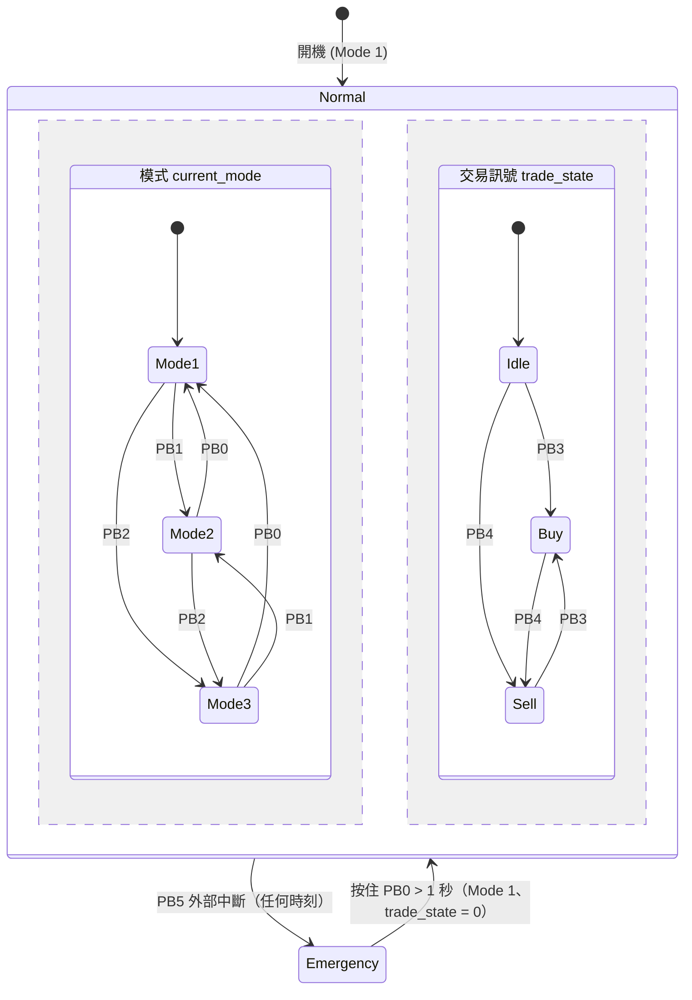

# STM32 Stock Simulator

以 **STM32 Nucleo-G474RE** 實作的「股票策略模擬器」。透過麵包板上的按鈕切換策略模式、送出買賣訊號，並以 LED 燈號與 PWM 呼吸燈呈現狀態；另有一顆**硬體外部中斷**的緊急中止按鈕，展現中斷的即時性。所有事件同時透過 UART 輸出到電腦終端機。

## 功能特色

- **三種策略模式**：保守 / 平衡 / 積極，對應不同顏色 LED 與呼吸燈速度
- **買賣訊號**：買入（綠燈）、賣出（紅燈）
- **緊急中止（EXTI 中斷）**：按下即刻關閉所有輸出並點亮警示燈，不需等待主迴圈
- **非阻塞式呼吸燈**：以 `HAL_GetTick()` 計時，PA8 使用 TIM1 PWM
- **軟體防彈跳**：200 ms
- **UART 日誌**：每次狀態變化都會輸出訊息

## 硬體需求

| 項目 | 說明 |[stm32g474_stock_sim_presentation.pdf](https://github.com/user-attachments/files/34308428/stm32g474_stock_sim_presentation.pdf)

| --- | --- |
| 開發板 | NUCLEO-G474RE |
| 按鈕 | 6 顆（PB0 ~ PB5），一端接 GPIO、另一端接 GND |
| LED | 6 顆（PC0 ~ PC5）+ 1 顆呼吸燈（PA8），建議各串接限流電阻 |
| 連線 | USB（ST-LINK 供電、燒錄與虛擬序列埠） |

### 腳位對應

| 腳位 | 方向 | 功能 | 備註 |
| --- | --- | --- | --- |
| PB0 | 輸入（上拉） | 切換至 Mode 1；緊急中止時按住 1 秒解除 | 低電位有效 |
| PB1 | 輸入（上拉） | 切換至 Mode 2 | 低電位有效 |
| PB2 | 輸入（上拉） | 切換至 Mode 3 | 低電位有效 |
| PB3 | 輸入（上拉） | 買入訊號 | 低電位有效 |
| PB4 | 輸入（上拉） | 賣出訊號 | 低電位有效 |
| PB5 | 外部中斷（下降緣、上拉） | 緊急中止 | EXTI9_5，優先權 0 |
| PC0 | 輸出 | Mode 1 指示燈（綠） | |
| PC1 | 輸出 | Mode 2 指示燈（黃） | |
| PC2 | 輸出 | Mode 3 指示燈（藍） | |
| PC3 | 輸出 | 買入指示燈（綠） | |
| PC4 | 輸出 | 賣出指示燈（紅） | |
| PC5 | 輸出 | 緊急中止警示燈（紅） | |
| PA8 | TIM1_CH1 (PWM) | 呼吸燈 | 1 kHz，解析度 1000 |

## 操作說明

| 操作 | 結果 |
| --- | --- |
| 按 PB0 / PB1 / PB2 | 切換到 Mode 1 / 2 / 3，點亮對應燈號，呼吸燈速度變為 ×1 / ×2 / ×3 |
| 按 PB3 | `trade_state = 1`，PC3 亮、PC4 滅 |
| 按 PB4 | `trade_state = 2`，PC4 亮、PC3 滅 |
| 按 PB5 | 進入緊急中止：PWM 歸零、PC0 ~ PC4 全滅、PC5 亮 |
| 緊急中止時按住 PB0 超過 1 秒 | 解除，回到 Mode 1，`trade_state` 歸零 |

## 狀態機

系統有兩組彼此獨立的狀態（模式、交易訊號），外加最高優先權的緊急中止旗標。



| 狀態 | LED / 輸出 | 呼吸燈速度 |
| --- | --- | --- |
| Mode 1（保守） | PC0 綠 | ×1 |
| Mode 2（平衡） | PC1 黃 | ×2 |
| Mode 3（積極） | PC2 藍 | ×3 |
| Buy | PC3 亮、PC4 滅 | 不變 |
| Sell | PC4 亮、PC3 滅 | 不變 |
| Emergency | PC5 亮，其餘全滅，PWM = 0 | 停止 |

## 系統設定

| 項目 | 設定 |
| --- | --- |
| 系統時脈 | HSI → PLL（M = 4、N = 85、R = 2），SYSCLK = 170 MHz |
| TIM1 | Prescaler = 169、Period = 999（1 MHz 計數，PWM 頻率 1 kHz） |
| 呼吸燈 | 每 10 ms 更新一次，步進 5 × 模式倍率，占空比範圍 50 ~ 1000 |
| 按鈕防彈跳 | 200 ms（軟體） |
| UART | LPUART1，115200 bps、8N1、無流控 |

## 序列埠輸出範例

以 115200 bps 開啟終端機（PuTTY、Tera Term、`screen` 皆可），即可看到：

```text
=== Stock Simulator System Ready (Mode 1) ===
[MODE] Switched to Mode 2 (Balanced | Yellow LED)
[STOCK] >>> BUY Signal Triggered! (Green LED ON)
[STOCK] <<< SELL Signal Triggered! (Red LED ON)
[ALERT] !!! EMERGENCY STOP TRIGGERED (Red LED ON) !!!
[SYSTEM] Emergency Cleared! Back to Mode 1.
```

## 建置與燒錄

1. 安裝 [STM32CubeIDE](https://www.st.com/en/development-tools/stm32cubeide.html)
2. 使用 **File → Open Projects from File System** 匯入本專案
3. 連接 Nucleo 板，點選 **Run** 或 **Debug** 燒錄
4. 開啟序列終端機（115200 bps），按下 RESET 即可看到開機訊息

如需修改腳位或周邊，請編輯 `.ioc` 檔後重新產生程式碼；自訂程式請寫在 `USER CODE BEGIN / END` 區塊內，以免被覆蓋。

## 專案結構

```text
.
├── Core/
│   ├── Inc/main.h
│   └── Src/main.c        # 狀態機、按鈕掃描、呼吸燈、UART 日誌、EXTI 回呼
├── *.ioc                 # STM32CubeMX 設定檔
└── README.md
```

## 已知限制與改進方向

- 買入 / 賣出狀態只能由緊急中止解除重置，尚無「取消訊號」的轉移
- 緊急中止的解除條件為 `now - last_btn_time > 1000` 且 PB0 目前為按下狀態，因此不是嚴格的「連續按住 1 秒」；若需精確判斷，可另外記錄 PB0 開始被按下的時間
- 中斷回呼內呼叫 `HAL_UART_Transmit`（阻塞式）會延長中斷時間，可改用旗標，由主迴圈輸出訊息，或改用 DMA / 中斷傳輸
- 按鈕以輪詢方式掃描，可改為 EXTI 搭配計時器去彈跳

## 授權

STM32 HAL 與 CubeMX 產生的程式碼版權屬 STMicroelectronics，依其隨附授權條款使用。使用者自訂部分請自行加入授權（例如 MIT）。
